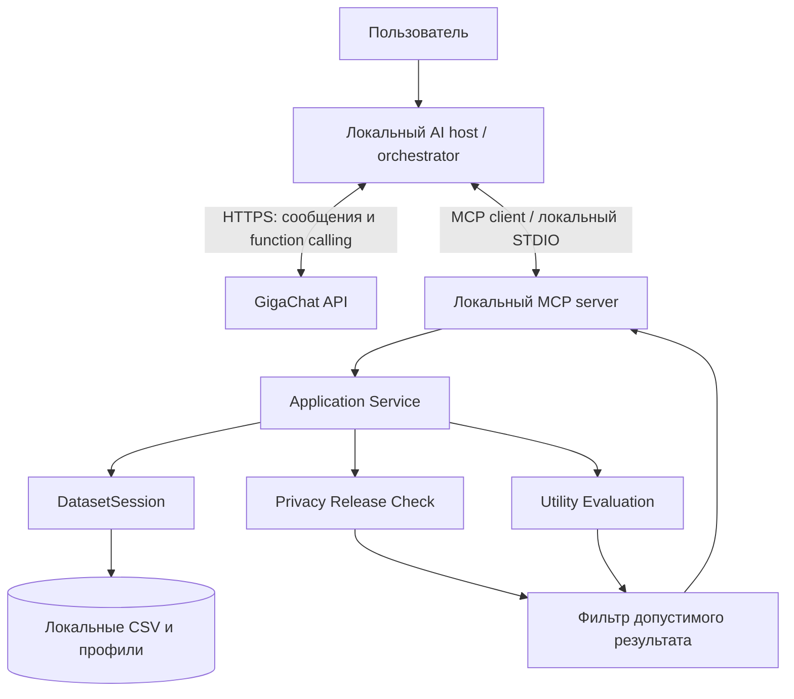

# Подготовка архитектуры интеграции с GigaChat и MCP

**Статус:** проектное решение для будущей версии 0.6.x. В версии 0.5.2 нет подключения к GigaChat API и нет MCP-сервера.

## Почему нужен локальный посредник

GigaChat вызывается через облачный API. Локальный MCP-сервер, работающий как дочерний процесс через STDIO, сам по себе не становится доступным облачной модели из интернета. Между API GigaChat и локальными инструментами должен работать процесс на компьютере пользователя или во внутренней сети организации.

Этот процесс будет выполнять роль локального AI host/orchestrator:

1. Отправлять сообщения и описания доступных функций в GigaChat API по HTTPS.
2. Получать от модели название функции и аргументы.
3. Проверять аргументы, права доступа и необходимость подтверждения.
4. Вызывать локальный MCP-сервер через MCP-клиент.
5. Получать результат и фильтровать его перед отправкой в контекст GigaChat.
6. Передавать модели только допустимую сводку/агрегаты, а не исходные строки CSV.

Схема:

## Как соотносятся GigaChat function calling и MCP

Документация Sber описывает пользовательские функции GigaChat: приложение передаёт модели описания функций, модель генерирует аргументы, приложение самостоятельно выполняет соответствующую функцию и возвращает результат модели сообщением с ролью `function`.

Поэтому в нашей целевой архитектуре не следует предполагать, что облачная модель напрямую подключится к локальному MCP-серверу. Локальный AI host будет адаптером между function calling GigaChat и MCP-инструментами сервиса.

Официальная документация:

- [Работа с функциями GigaChat](https://developers.sber.ru/docs/ru/gigachat/guides/functions/overview)
- [Метод генерации ответа и пользовательские функции](https://developers.sber.ru/docs/ru/gigachat/api/reference/rest/post-chat)
- [Авторизация и базовый URL GigaChat API](https://developers.sber.ru/docs/ru/gigachat/api/reference/rest/gigachat-api)

По документации Sber, целевой REST URL для новых подключений с 17 июля 2026 года — `https://api.giga.chat`. Токен доступа выдаётся на ограниченный срок (указано 30 минут); точные требования нужно повторно проверить при начале интеграции.

## Планируемые инструменты

Предварительный перечень MCP-инструментов:

- `inspect_dataset` — описание выбранного набора и его структуры;
- `classify_attributes` — предложения по ролям и обнаружение пропущенных назначений;
- `prepare_anonymization_plan` — сформировать план без выполнения;
- `execute_anonymization` — выполнить подтверждённый план;
- `evaluate_privacy` — получить результат Privacy Release Check;
- `analyze_dataset` — получить допустимую статистическую сводку;
- `compare_utility` — сравнить исходную и обработанную таблицы.

Финальная схема аргументов и результата будет определена после тестирования GigaChat function calling и выбора конкретной версии MCP SDK.

## Обязательные границы безопасности

- Не предоставлять модели инструмент чтения произвольных строк исходного CSV.
- Не включать в ответы инструмента значения прямых идентификаторов и таблицу соответствий токенов.
- Не разрешать модели произвольные абсолютные пути; использовать разрешённые dataset ID и рабочие каталоги.
- Разделять просмотр/планирование и изменение данных.
- Требовать подтверждение пользователя перед созданием результата, перезаписью или экспортом.
- Не отдавать в контекст модели отчёты или агрегаты, которые раскрывают небольшие группы или отдельные записи.
- Не считать `ready` абсолютной гарантией анонимности; MCP host должен применять собственную политику выдачи результатов.
- Не хранить API key, client secret или access token в репозитории, `app.json`, профилях CSV либо логах. Секрет будет храниться в локальном защищённом хранилище или переменных окружения.

## Что не входит в 0.5.2

Никаких HTTP-запросов к GigaChat, MCP transport, API key form, OAuth/token manager или автоматического вызова моделей в 0.5.2 нет. Текущая версия только готовит общий прикладной слой, который позднее смогут использовать GUI, CLI и MCP.
